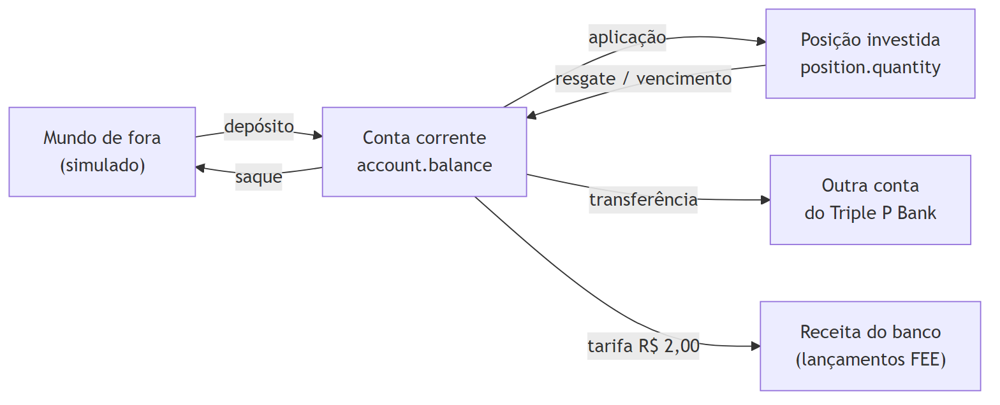
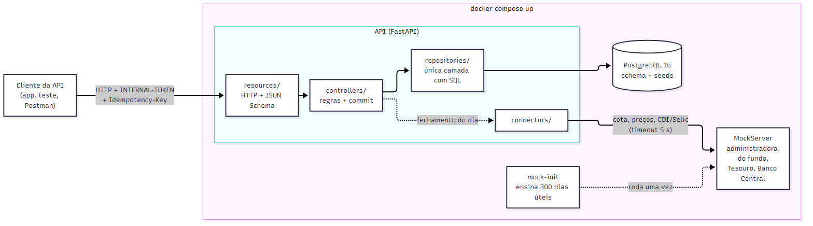
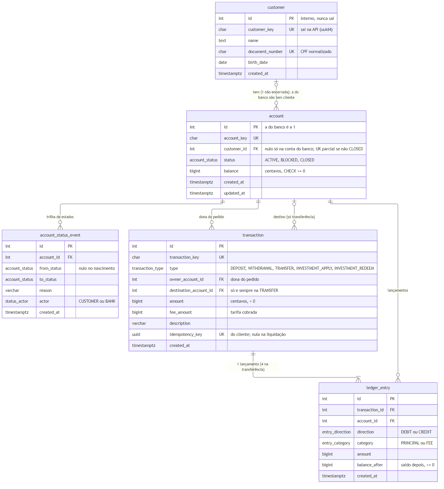
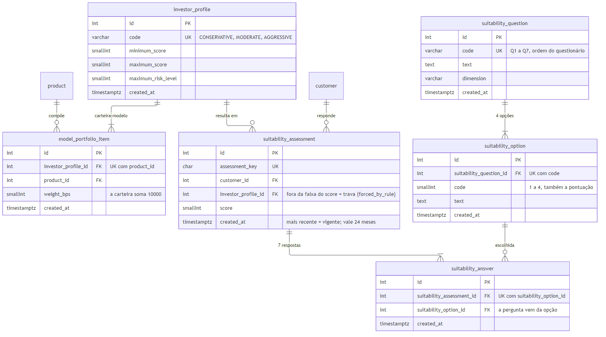
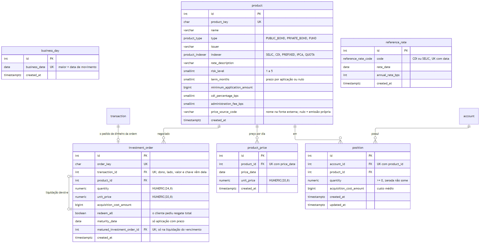
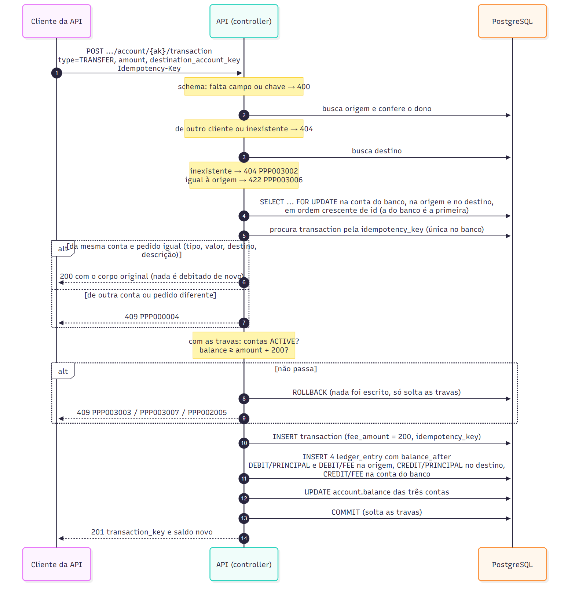
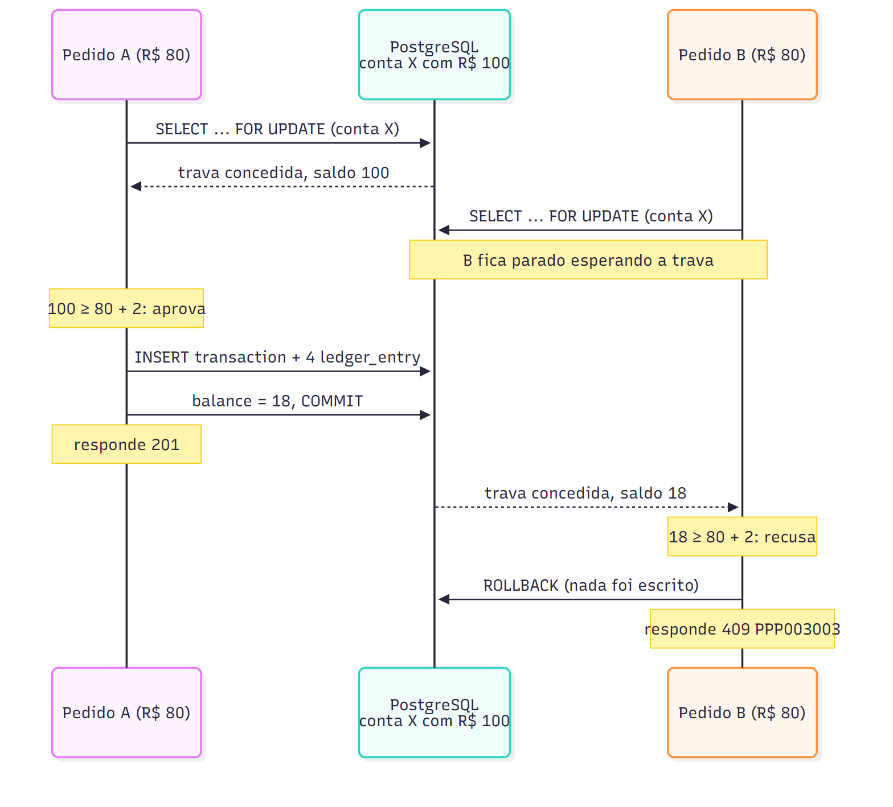
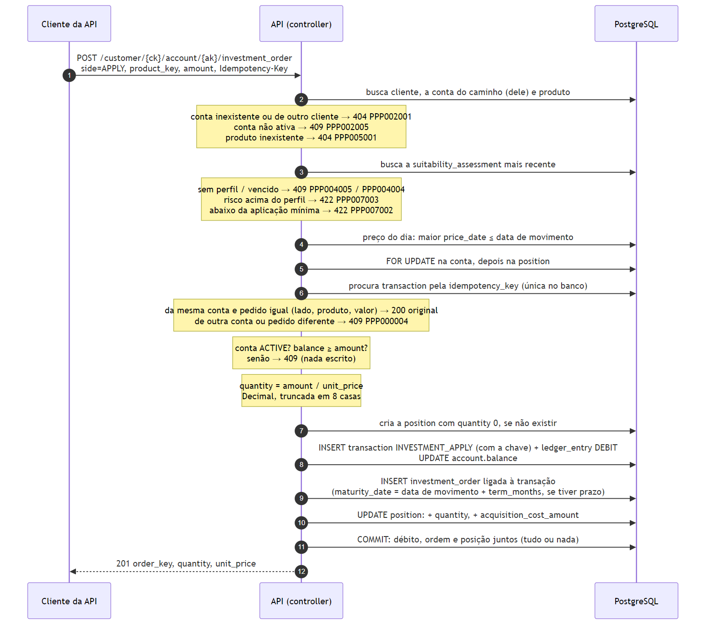
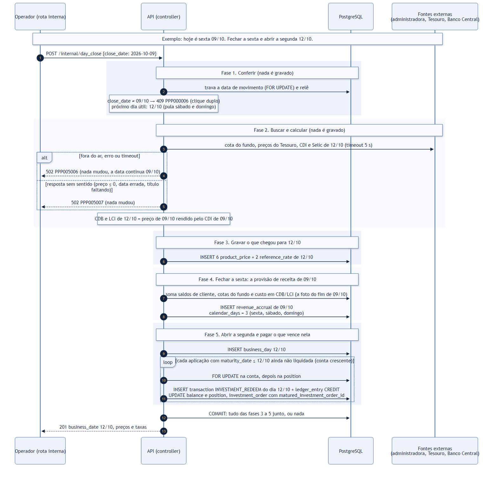

# RFC — Triple P Bank: banco digital com investimentos simulados, sem criar nem perder um centavo

| | |
|---|---|
| **Time** | Lucas Heluy · Álvaro Duarte · Thomas Miguellone |
| **Data** | 08/10/2026 |
| **Versão** | 2 (revisão do banco depois do feedback da QI Tech) |

## Contextualização

### Entendendo o problema

O Triple P Bank é a API de um banco digital. Quem a usa é um aplicativo ou integrador agindo em nome
de clientes pessoa física, e a operação interna do banco. Para o cliente, ela cadastra, abre a conta
corrente, deposita, saca, transfere com tarifa e mostra o extrato. No módulo de investimentos, ela
calcula o perfil do investidor, sugere uma carteira, aplica e resgata em renda fixa e no fundo
fictício FGV Quant Capital e mostra posição e rentabilidade. Para a operação, ela vira o dia, com os
preços buscados lá fora, e mede a receita do banco.

A garantia é que nenhum centavo é criado, duplicado ou some. O saldo nunca fica negativo. O extrato
sempre reconstrói o saldo. Um pedido reenviado depois de um timeout não move o dinheiro duas vezes.
Uma falha no meio não deixa débito sem crédito ou sem posição. Nada do que foi registrado é apagado.
Um cliente nunca enxerga o recurso de outro. Se isso falha, o banco paga em dobro, o cliente perde
dinheiro ou o extrato deixa de servir como prova.

**Fora do escopo:** autenticação do cliente final, Pix/TED reais, pessoa jurídica, crédito, ações,
cripto e preço em tempo real, imposto de renda e IOF, feriados e front-end.

### Explicando a solução de forma macro

O dinheiro só mora em dois lugares: o saldo da conta corrente e a posição investida. Cada seta do
desenho abaixo é **uma** transação do PostgreSQL. Ela grava o pedido (`transaction` ou
`investment_order`), os lançamentos do extrato (`ledger_entry`) e o novo saldo ou posição, e o
`commit` é a última coisa que acontece. Antes de decidir, a API trava com `SELECT ... FOR UPDATE`
toda linha que leu, sempre na mesma ordem. Ela também confere a `Idempotency-Key` já com a trava
segurada, e um `UNIQUE` no banco serve de rede de segurança. Os preços dos produtos chegam uma vez
por dia, no fechamento do dia, vindos das fontes externas (simuladas por um MockServer). Eles ficam
gravados, então nenhum pedido de cliente depende de um serviço de fora estar no ar. O "hoje" do
banco é uma data de movimento própria, que só avança pelo fechamento. É ela que permite mostrar
"aplica no dia *t*, resgata no dia *t + n*" em segundos.

#### Glossário rápido

| Termo | O que significa aqui |
|---|---|
| Centavos | Todo valor em dinheiro é um inteiro em centavos (`BIGINT`): R$ 2,00 é `200`. Nunca `float`. Colunas e campos de dinheiro terminam em `_amount`. |
| Pontos-base (`_bps`) | Percentual em inteiro: `10000` = 100%, `150` = 1,5%. |
| `id` × `key` | `id` é o número interno da linha e nunca sai na API. A `..._key` (um UUID) é o que o cliente usa nas rotas. |
| Data de movimento | O "hoje" do banco (`business_date`). Só avança quando a operação fecha o dia. |
| Cota | A fração de um produto que o cliente compra. Aplicar R$ 100 num produto de preço R$ 1,25 dá 80 cotas. |
| Posição | Quanto a conta tem de cada produto: cotas e custo (`acquisition_cost_amount`). |
| Aplicação / resgate | Dinheiro saindo da conta para um produto / voltando do produto para a conta. |
| Débito / crédito | Dinheiro saindo / entrando num saldo. |
| `PRINCIPAL` / `FEE` | Categoria do lançamento: o valor da operação / a tarifa. |
| `Idempotency-Key` | Um UUID que o cliente da API manda em cada pedido de dinheiro, para um reenvio não repetir o efeito. |

#### As tabelas e quem é dono do quê

**A conta é a dona de tudo que envolve dinheiro.** O cliente tem a conta; a conta tem os pedidos,
o extrato e os investimentos. Cada tabela tem um papel só:

| Tabela | Papel | Uma linha é… |
|---|---|---|
| `transaction` | **O pedido** de dinheiro | um depósito, saque, transferência, aplicação ou resgate. Guarda o tipo, o valor, a tarifa, a conta dona (`owner_account_id`), o destino (só na transferência) e a chave de idempotência. |
| `ledger_entry` | **O extrato** | um efeito em **um** saldo: débito ou crédito, quanto, e o saldo logo depois (`balance_after`). |
| `investment_order` | **O anexo** do pedido de investimento | o que só aplicação e resgate têm: produto, cotas, preço do dia e custo. Dono, lado e valor ficam na `transaction` dela. |
| `position` | **O que a conta tem** | cotas e custo de um produto naquela conta. |

Exemplo: **Ana (saldo R$ 1.000,00) transfere R$ 200,00 para Bruno (saldo R$ 50,00).** O pedido vira
uma linha em `transaction` e quatro em `ledger_entry`, gravadas juntas num único `commit`:

| `ledger_entry` | Conta | Direção | Categoria | Valor | Saldo depois |
|---|---|---|---|---|---|
| 1 | Ana | DEBIT | PRINCIPAL | 20000 | 80000 |
| 2 | Ana | DEBIT | FEE | 200 | 79800 |
| 3 | Bruno | CREDIT | PRINCIPAL | 20000 | 25000 |
| 4 | Banco | CREDIT | FEE | 200 | 200 |

Antes: 100000 + 5000 + 0 = 105000 centavos. Depois: 79800 + 25000 + 200 = 105000. Nenhum centavo
foi criado ou sumiu. Depósito, saque, aplicação e resgate geram um lançamento só. O saldo da conta
(`account.balance`) é sempre a soma dos créditos menos a soma dos débitos dela no extrato.

As rotas seguem o mesmo dono: tudo que mexe com dinheiro fica embaixo da conta,
`/customer/{ck}/account/{ak}/...` (movimentações, extrato, ordens e posição). Perfil e carteira
sugerida ficam no cliente, porque são da pessoa.

*Por que assim:* na versão 1 a ordem e a posição eram do cliente, e a transação tinha três colunas de
conta. Eram dois caminhos para saber "de quem é", e um deles repetia o outro.

#### Idempotência: o mesmo pedido nunca move o dinheiro duas vezes

**O problema.** O app manda "transferir R$ 200", o banco executa, e a internet cai antes da resposta
chegar. O app não sabe se deu certo e reenvia. Sem proteção, Ana pagaria duas vezes.

**O que fizemos.** Quem chama a API gera um UUID novo por pedido e manda no cabeçalho
`Idempotency-Key`. No reenvio, manda a **mesma** chave. O banco guarda a chave na `transaction`, com
`UNIQUE` no banco inteiro. Quando a chave chega de novo, o banco compara o pedido com o que já gravou
(tipo, valor, destino e descrição; na ordem, lado, produto e valor):

| Situação (mesma chave) | Resposta |
|---|---|
| Reenvio do mesmo pedido, pela mesma conta | `200` com a resposta original. Nada se move de novo. |
| Mesma conta, valor diferente (ou outro tipo, destino, produto) | `409` (`PPP000004`): é outro pedido usando uma chave já usada. |
| Chave já usada por outra conta | `409`, sem mostrar nada do pedido do outro. |
| Chave de um depósito mandada numa aplicação | `409`. |

A checagem acontece **depois** de travar as contas. Se o reenvio chega enquanto o original ainda
roda, ele espera a trava e depois encontra o pedido gravado, em vez de ver o saldo já debitado e
receber um falso "saldo insuficiente". Sem cabeçalho, ou fora do formato UUID: `400`.

*Por que assim:* na versão 1 a chave era única por dono e guardada em dois lugares, com um hash do
corpo. Reusar numa aplicação a chave de um depósito dava `500`.

#### Dinheiro e receita

**A tarifa entra numa conta do banco.** O banco tem uma conta própria, sem cliente, criada pelo seed.
Toda tarifa é um débito na conta de quem transfere e um crédito nela: todo débito tem o seu crédito,
como na contabilidade. Com isso, a soma de todos os saldos só muda com dinheiro que entra ou sai do
sistema:

> Σ saldos = Σ depósitos − Σ saques − Σ aplicações + Σ resgates

Exemplo: Ana deposita R$ 1.000 e Bruno, R$ 500 (Σ = 1.500). Ana transfere R$ 200: Ana 798, Bruno 700,
banco 2 (Σ = 1.500). Ana aplica R$ 300: Ana 498 (Σ = 1.200 = 1.500 − 300).

**Como o banco ganha dinheiro.** A conta gratuita e o Tesouro Direto sem taxa trazem o cliente. O
perfil do investidor e a carteira sugerida levam parte do dinheiro dele para os produtos da casa (o
fundo, o CDB e a LCI), que é onde está a margem.

| Fonte | Como funciona | Tipo |
|---|---|---|
| Tarifa de transferência | R$ 2,00 por transferência: sai da conta de origem e entra na conta do banco (lançamentos `FEE`). | Realizada |
| Taxa de administração do fundo | 1% ao ano sobre o patrimônio do FGV Quant Capital, já descontada da cota. | Estimada |
| Spread dos títulos próprios | O banco paga 95% do CDI no CDB e 93% na LCI e aplica o dinheiro captado a cerca de 100% do CDI. | Estimada |
| Float | O saldo parado na conta não rende para o cliente; o banco o aplica à Selic. | Estimada |
| Tesouro Direto | Sem taxa: é o produto de atração. | Nenhuma |

Só a tarifa move dinheiro de verdade. As outras três são o que o banco *ganharia* com o dinheiro sob
sua guarda: o relatório `/internal/revenue` calcula, mas não grava nada nem mexe em saldo. Separar
realizada de estimada é o que deixa o número defensável.

**O capital do cliente.** O `balance` da conta é só o dinheiro parado nela; o que foi aplicado sai
do saldo e vira posição. Por isso a consulta da conta (`GET /customer/{ck}/account/{ak}`) traz também
`investments_amount` (as posições ao preço do dia) e `net_worth_amount` (saldo + investimentos).
`GET /customer/{ck}/account/{ak}/positions` mostra o mesmo total, além de cada investimento e da divisão entre caixa
e investimentos em pontos-base; as duas rotas usam a mesma função de preço, então os números batem. Com Ana do exemplo (R$ 498 em caixa e R$ 300 investidos):
`investments_amount = 30000`, `net_worth_amount = 79800`, `cash_bps = 6240` (62,4%) e `investments_bps = 3760`. É calculado na
hora da leitura e não gravado, porque o valor dos investimentos muda a cada fechamento do dia.

#### Investimentos e o "hoje" do banco

**A data de movimento.** O banco tem o próprio "hoje" (`business_day`), que só avança quando a
operação chama `POST /internal/day_close`. Com o relógio real, o dia seguinte levaria 24 horas, e não
daria para mostrar "aplica hoje, resgata daqui a um mês". Idade mínima e validade do perfil continuam
no relógio real, porque são regras da lei.

**O preço do dia.** No fechamento, o banco busca o preço de cada produto nas fontes externas (Tesouro
e administradora do fundo, simulados por um MockServer) e o grava em `product_price`. CDB e LCI são
do próprio banco: o preço sai do CDI. Durante o dia, toda aplicação e resgate usam o preço gravado,
então nenhum pedido depende de um serviço de fora estar no ar, e dois clientes no mesmo dia veem o
mesmo preço.

**Cotas e custo médio, linha a linha no banco.** Ana tem R$ 2.000,00 na conta e investe no fundo.
Nas tabelas, os valores estão como ficam gravados: dinheiro em centavos, cotas e preço com 8 casas.

**Passo 1 — dia t, cota a R$ 1,25. Ana aplica R$ 1.000,00.** Ela compra 1.000 ÷ 1,25 = **800 cotas**.
O banco grava, num único `commit`:

| Tabela | Linha gravada |
|---|---|
| `transaction` (T1) | `type` = INVESTMENT_APPLY · `owner_account_id` = Ana · `amount` = 100000 · `idempotency_key` = a chave do pedido |
| `ledger_entry` | `transaction_id` = T1 · conta Ana · DEBIT · PRINCIPAL · `amount` = 100000 · `balance_after` = 100000 |
| `investment_order` (O1) | `transaction_id` = T1 · produto = fundo · `quantity` = 800.00000000 · `unit_price` = 1.25000000 · `acquisition_cost_amount` = 100000 |
| `position` (nova) | conta Ana · fundo · `quantity` = 800.00000000 · `acquisition_cost_amount` = 100000 |
| `account` (Ana) | `balance`: 200000 → **100000** |

O `acquisition_cost_amount` da posição é o **custo**: quanto Ana pagou pelas cotas que tem hoje.

**Passo 2 — dia t + n, a cota sobe para R$ 1,30.** O fechamento do dia grava uma linha nova em
`product_price` (fundo, `price_date` = *t + n*, `unit_price` = 1.30000000). **Nenhuma linha da Ana
muda.** A posição ao preço do dia é calculada na hora da consulta (`GET .../positions`): 800 × 1,30 =
R$ 1.040,00 (`current_amount` = 104000), lucro de R$ 40,00 sobre o custo de R$ 1.000,00
(`return_bps` = 400, ou 4%).

**Passo 3 — Ana resgata R$ 520,00.** Com a cota a R$ 1,30, isso são 520 ÷ 1,30 = **400 cotas**, a
metade das 800. Essas 400 cotas custaram metade do que ela pagou: **R$ 500,00**. É esse custo que sai
da posição (custo médio: vendeu metade das cotas, sai metade do custo).

| Tabela | Linha gravada ou alterada |
|---|---|
| `transaction` (T2) | `type` = INVESTMENT_REDEEM · `owner_account_id` = Ana · `amount` = 52000 · `idempotency_key` = a chave deste pedido |
| `ledger_entry` | `transaction_id` = T2 · conta Ana · CREDIT · PRINCIPAL · `amount` = 52000 · `balance_after` = 152000 |
| `investment_order` (O2) | `transaction_id` = T2 · produto = fundo · `quantity` = 400.00000000 · `unit_price` = 1.30000000 · `acquisition_cost_amount` = **50000** (o custo que saiu) |
| `position` (a mesma) | `quantity`: 800 → **400** · `acquisition_cost_amount`: 100000 → **50000** |
| `account` (Ana) | `balance`: 100000 → **152000** |

A resposta do resgate traz `acquisition_cost_amount` = 50000, `result_amount` = 52000 − 50000 = **2000**
(R$ 20,00 de lucro) e `return_bps` = 400 (4% sobre os R$ 500,00 que saíram). Ana ficou com R$ 1.520,00
na conta e 400 cotas que custaram R$ 500,00 e hoje valem R$ 520,00.

Cotas são truncadas em 8 casas; valores em reais são arredondados para baixo em centavos. Nenhuma
linha é apagada nem editada além de `account.balance` e `position`: o histórico fica em
`transaction`, `ledger_entry` e `investment_order`.

**Vencimento da LCI.** A LCI tem prazo de 12 meses por aplicação e não pode ser resgatada antes. No
fechamento do dia em que uma aplicação vence, o próprio banco faz o resgate dela, ao preço do dia, e
devolve o dinheiro à conta. A ordem de resgate aponta para a aplicação que pagou
(`matured_investment_order_id`, `UNIQUE`): a mesma aplicação nunca é paga duas vezes.

**Considerado e descartado:**

- **Saldo só como soma do extrato** (sem coluna `balance`): descartada porque toda leitura de saldo
  vira uma soma sobre o histórico inteiro, e a corrida entre dois pedidos continua existindo. Ganharia
  se o volume fosse pequeno e quiséssemos zero redundância. Ficamos com `balance` + `balance_after` em
  cada lançamento, e um teste confere que os dois batem.
- **`UPDATE ... SET balance = balance - x WHERE balance >= x`, sem trava explícita:** descartada
  porque a transferência precisa ler duas contas e o status delas antes de decidir. A trava explícita
  é mais fácil de explicar e de testar. Ganharia se só uma conta fosse afetada e o desempenho pesasse
  mais.
- **Tarifa sem conta de destino** (a receita como soma dos débitos `FEE`), escolha da versão 1:
  descartada porque a tarifa saía do cliente e não entrava em lugar nenhum. Agora uma conta do banco,
  sem cliente, recebe o crédito: todo débito tem o seu crédito. O preço é que toda transferência trava
  a *mesma* linha; se virar gargalo, a tarifa passa a ser acumulada e creditada no fechamento do dia.
- **Chave de idempotência única por dono, com hash do corpo** (versão 1): descartada porque a chave
  existia em dois lugares e reusar numa aplicação a chave de um depósito dava `500`. Agora a chave é
  `UNIQUE` no banco inteiro, mora só em `transaction`, e a repetição é conferida comparando o pedido
  com as colunas já gravadas, sem hash.
- **Tabelas de enumerador e colunas que repetem outras** (versão 1): descartadas por complexidade sem
  ganho. Listas fixas viraram tipos ENUM do Postgres, a ordem de investimento virou o anexo da sua
  transação, a posição passou a ser da conta, e o que pode ser calculado deixou de ser gravado. O banco
  foi de 21 para 17 tabelas.
- **Nomes curtos ou genéricos de coluna** (`profile_id`, `min_score`, `reference_date` em três
  tabelas), versão 1: descartados porque obrigavam a abrir o schema para saber o que a coluna guarda.
  Agora a chave estrangeira leva o nome completo da tabela de destino (`investor_profile_id`), com o
  papel na frente quando há mais de uma (`owner_account_id`, `destination_account_id`); `minimum` e
  `maximum` por extenso; dinheiro termina em `_amount`; cada data diz de quê é (`business_date`,
  `price_date`). Banco e API usam o mesmo vocabulário.
- **Buscar o preço lá fora na hora da aplicação:** descartada porque cada pedido do cliente passaria a
  depender de outro serviço, e dois clientes no mesmo dia poderiam ver preços diferentes. Ganharia com
  ativos de preço minuto a minuto, como ações.
- **Relógio real como "hoje":** descartada porque o dia seguinte só chegaria depois de 24 h, e não daria
  para testar nem demonstrar rendimento e vencimento. Ganharia sem rentabilidade para mostrar. Idade
  mínima e validade do perfil continuam no relógio real, porque são fatos regulatórios.
- **Uma rota só para bloquear, desbloquear e encerrar a conta:** descartada porque, com o mesmo
  `INTERNAL-TOKEN` para todos, um cliente bloqueado por fraude ou ordem judicial conseguia se
  desbloquear. Separar as rotas sem credencial nova também não bastava: quem tem o token chamaria a
  rota do banco do mesmo jeito. Ganharia com autenticação real do cliente ou com um *gateway* que só
  expõe `/customer/...`. Ficamos com o cliente só encerrando e o banco bloqueando e desbloqueando
  pela rota interna, protegida pelo `OPERATOR-TOKEN`.
- **Ordens e posição em rotas do cliente** (`/customer/{ck}/investment_order`, `/customer/{ck}/positions`),
  com a API escolhendo a conta por baixo dos panos: descartada porque no banco a ordem e a posição
  já são da conta, e as movimentações já ficavam em `/customer/{ck}/account/{ak}/`. Agora as duas
  seguem o mesmo caminho, o cliente diz de qual conta sai o dinheiro, e a conta de outro cliente dá
  `404` como em todo o resto.
- **Uma rota só para movimentação e ordem** (`POST .../transaction` com `type = INVESTMENT_APPLY`):
  descartada porque pedido, resposta e erros são outros (produto, cotas, preço, perfil, mínimo,
  prazo); o schema e o controller virariam um `if` por tipo. A ligação já existe: toda ordem gera
  uma `transaction`, que aparece no extrato e tem comprovante.

## Implementação

### Rotas

Toda rota exige o cabeçalho `INTERNAL-TOKEN`, menos `/` e `/health_check`. Sem ele, a resposta é
`403` (`PPP000002`). As rotas `/internal/...` são da operação do banco e exigem também o cabeçalho
`OPERATOR-TOKEN`; sem ele ou com valor errado, `403` (`PPP000007`). O cliente só tem o primeiro
token, e é isso que o impede de se desbloquear sozinho. Um recurso de outro cliente responde `404`,
igual a um inexistente. As rotas marcadas como
**idempotentes** exigem o cabeçalho `Idempotency-Key`, um UUID gerado por quem chama a API, um por
pedido; sem ele ou fora do formato, `400` (`PPP000003`). A chave é `UNIQUE` no banco inteiro
(`transaction.idempotency_key`). Se ela voltar da mesma conta com o mesmo pedido (comparado com o que
já está gravado), a resposta é `200` com o corpo original e nada se move de novo. Se vier de outra
conta ou com um pedido diferente, `409` (`PPP000004`). `ck` = `customer_key`, `ak` = `account_key`.

| Método | Caminho | O que faz | Entrada (campos que importam) | Saídas (status e quando) |
|---|---|---|---|---|
| `POST` | `/customer` | Cadastra cliente | `name`, `document_number` (com ou sem pontuação), `birth_date` | `201` `customer_key`; `400` schema; `409` CPF já cadastrado; `422` CPF inválido ou menor de 18 |
| `GET` | `/customer/{ck}` | Lê o cliente (CPF mascarado) | — | `200`; `404` |
| `POST` | `/customer/{ck}/account` | Abre a conta corrente (nasce `ACTIVE`, saldo 0) | — | `201` `account_key`; `404` cliente; `409` já tem conta não encerrada |
| `GET` | `/customer/{ck}/account/{ak}` | Status, saldo, valor investido e capital total | — | `200`; `404` |
| `PATCH` | `/customer/{ck}/account/{ak}` | O cliente encerra a própria conta (só vazia), gerando evento | `status`, `reason` | `200`; `400` status fora do enum; `403` bloquear ou desbloquear (só o banco); `404`; `409` transição proibida ou conta não vazia; `422` sem motivo |
| `PATCH` | `/internal/account/{ak}/status` | O banco bloqueia, desbloqueia ou encerra, gerando evento. Exige `OPERATOR-TOKEN` | `status`, `reason` | `200`; `400` schema; `403` sem token de operador; `404`; `409` transição proibida ou conta não vazia; `422` sem motivo |
| `GET` | `/customer/{ck}/account/{ak}/status_events` | Trilha de status, com quem fez cada mudança (`CUSTOMER` ou `BANK`) | — | `200`; `404` |
| `POST` | `/customer/{ck}/account/{ak}/transaction` | Depósito, saque ou transferência (tarifa de R$ 2,00, creditada na conta do banco). **Idempotente** | `type`, `amount` (centavos), `destination_account_key` | `201` `transaction_key` e saldo; `200` repetição; `400` schema ou sem chave; `404` conta ou destino; `409` conta/destino não ativos, saldo insuficiente, chave reutilizada; `422` valor ≤ 0, acima do limite, origem = destino |
| `GET` | `/customer/{ck}/account/{ak}/transactions` | Extrato paginado, do mais novo ao mais antigo | `page`, `limit`, `from`, `to`, `type` | `200` `{items, page, limit, total}`; `400` filtro inválido; `404` |
| `GET` | `/customer/{ck}/account/{ak}/transaction/{tk}` | Comprovante | — | `200`; `404` (inexistente ou não envolve a conta) |
| `GET` | `/suitability_questions` | Perguntas e opções (o código da opção, de 1 a 4, é a pontuação dela) | — | `200` |
| `POST` | `/customer/{ck}/suitability` | Responde o questionário e gera uma avaliação nova | `answers[{question_code, option_code}]` | `201` perfil, pontos, validade; `400` schema; `404`; `422` resposta faltando, repetida ou opção inválida |
| `GET` | `/customer/{ck}/suitability` | Perfil vigente (a avaliação mais recente) | — | `200`; `404` cliente ou nunca respondeu |
| `GET` | `/customer/{ck}/suitabilities` | Histórico de avaliações | — | `200`; `404` |
| `GET` | `/products` | Catálogo | `type`, `maximum_risk_level` | `200` |
| `GET` | `/product/{pk}` | Detalhe e preço do dia | — | `200`; `404` |
| `GET` | `/product/{pk}/prices` | Histórico de preços | `from`, `to` | `200`; `404` |
| `GET` | `/customer/{ck}/portfolio_suggestion` | Divide um valor pela carteira-modelo do perfil (não grava nada) | `amount` | `200` itens que somam exatamente `amount`; `400`; `404`; `409` sem perfil ou vencido; `422` abaixo de R$ 1.000 |
| `POST` | `/customer/{ck}/account/{ak}/investment_order` | Aplica ou resgata; o dinheiro sai ou entra nesta conta. **Idempotente** | `product_key`, `side`, `amount` ou `redeem_all` | `201` `order_key`, quantidade, preço (resgate: custo, resultado, rentabilidade); `200` repetição; `400` schema ou sem chave; `404` conta ou produto; `409` conta não ativa, sem perfil válido, saldo ou posição insuficiente, chave reutilizada; `422` abaixo do mínimo, fora do perfil, resgate antes do vencimento |
| `GET` | `/customer/{ck}/account/{ak}/investment_orders` | Histórico de ordens da conta | `page`, `limit`, `product_key` | `200` (produto inexistente: lista vazia); `400`; `404` |
| `GET` | `/customer/{ck}/account/{ak}/investment_order/{ok}` | Detalhe da ordem | — | `200`; `404` |
| `GET` | `/customer/{ck}/account/{ak}/positions` | Posição, valor do dia, rentabilidade e capital total na conta (caixa + investimentos, com a divisão em pontos-base) | `include_closed` | `200`; `400`; `404` |
| `GET` | `/internal/business_date` | Data de movimento atual. Exige `OPERATOR-TOKEN` | — | `200`; `403` sem token de operador |
| `POST` | `/internal/day_close` | Fecha o dia: busca preços e taxas lá fora, liquida o que venceu e abre o próximo dia útil. Clique duplo não fecha dois dias (trava + data conferida). Exige `OPERATOR-TOKEN` | `close_date` | `201` nova data, preços, taxas; `400`; `403` sem token de operador; `409` `close_date` não é a data atual; `502` fonte fora do ar ou resposta sem sentido (nada gravado) |
| `GET` | `/internal/revenue` | Receita realizada (tarifas) e estimada (fundo, spread, float). Exige `OPERATOR-TOKEN` | `from`, `to` | `200`; `400` período invertido ou maior que 366 dias; `403` sem token de operador |

### Banco de Dados (Somente diagrama)

**Núcleo bancário**

**Perfil do investidor e carteira sugerida**

**Produtos, preços, ordens e posição**

### Fluxos

Toda operação que move dinheiro segue a mesma ordem: **ler → travar → checar idempotência → decidir →
escrever → `commit`**. Nenhuma escrita acontece antes da última verificação, então uma recusa não tem
nada a desfazer. E como o `commit` é um só, um imprevisto no meio das escritas não deixa nada pela
metade: o middleware de sessão dá `rollback` e o banco volta a como estava.

**Transferência — caminho feliz**

**Transferência — falha: saldo insuficiente (a mais provável).** O passo de decisão recusa com as
duas contas travadas. Como nada foi escrito, o `rollback` só solta as travas. O cliente recebe `409`
(`PPP003003`) e os dois saldos continuam iguais.

**Transferência — falha: duas transferências da mesma conta ao mesmo tempo (a mais cara).** A conta
tem R$ 100 e chegam dois pedidos de R$ 80.

Sem a trava, A e B leriam R$ 100, os dois aprovariam e R$ 160 sairiam de uma conta com R$ 100 (*lost
update*). O `CHECK (balance >= 0)` ainda barraria o segundo, mas com um `500`, que é um ramo que
ninguém desenhou.

**Transferência — falha: o cliente reenvia o mesmo pedido.** Se o original ainda está rodando, o
reenvio espera na trava. Depois ele encontra a `transaction` já gravada com a mesma chave e, sendo o
mesmo pedido, devolve o corpo original (`200`). A checagem fica *depois* da trava de propósito: se viesse antes, o reenvio passaria por ela,
esperaria a trava e receberia um falso "saldo insuficiente".

**Transferência — falha: A → B e B → A ao mesmo tempo.** Se cada pedido travasse primeiro a própria
origem, cada um seguraria uma conta esperando a outra (*deadlock*). Travando sempre em ordem crescente
de `id`, os dois disputam a mesma primeira trava: um passa e o outro espera.

**Aplicação — caminho feliz**

A ordem das travas é sempre *conta, depois posição*. Como cada cliente tem uma só conta aberta, a
trava da conta enfileira todas as ordens daquele cliente, e a posição pode ser criada sem que duas
ordens tentem criá-la juntas.

**Aplicação — falha: produto acima do perfil (a mais provável).** A recusa acontece antes de qualquer
trava ou escrita, com `422` (`PPP007003`). Perfil vencido ou inexistente recusa no mesmo ponto, com
`409`.

**Aplicação — falha: exceção depois do débito (a mais cara).** O débito já está na sessão, mas a
ordem ou a posição não. O `rollback` desfaz débito, lançamento e ordem juntos: dinheiro nunca sai da
conta sem virar posição.

**Resgate — o que muda.** Não há checagem de perfil: o cliente sempre pode tirar o dinheiro. Com a
posição travada, a API confere `quantity` ≥ quantidade a resgatar (senão `409` `PPP007004`). Produto
com prazo (a LCI) antes do vencimento da aplicação dá `422` (`PPP007005`). O crédito é um
`INVESTMENT_REDEEM`, e a posição perde a quantidade e o custo na mesma proporção. Quando zera, a
posição fica com `quantity = 0` e não é apagada.

**Fechamento do dia — caminho feliz**

**Fechamento — falha: serviço externo fora do ar (a mais provável).** Erro, timeout de 5 s ou conexão
derrubada dão `502` (`PPP005006`). Nada foi escrito: a data não anda e vale o último preço publicado.
Basta chamar de novo. Uma resposta sem sentido (cota = 0, título faltando) dá `502` (`PPP005007`),
pelo mesmo caminho. Gravar um preço errado seria pior, porque preço publicado não se reescreve.

**Fechamento — falha: erro no meio da liquidação (a mais cara).** Preços gravados e uma aplicação já
paga, mas a próxima falha. Como tudo está num `commit` só, o `rollback` desfaz preços, taxas e
créditos juntos, e ninguém recebe pela metade. Uma aplicação nunca é paga duas vezes: depois de paga,
existe a ordem que aponta para ela, e o `UNIQUE(matured_investment_order_id)` barra a segunda.

> ## Principal desafio
>
> - **Qual é:** mover dinheiro entre contas, e entre conta e investimento, sem criar, duplicar ou
>   sumir com um centavo.
> - **Por que é difícil:** cada operação faz de três a cinco escritas em tabelas diferentes, e a
>   solução óbvia (ler o saldo, checar, escrever) quebra em três cenários. Com dois pedidos
>   simultâneos, os dois leem o mesmo saldo e R$ 160 saem de R$ 100. Com o cliente reenviando depois
>   de um timeout, a transferência sai duas vezes. Com uma falha no meio, o débito fica gravado sem a
>   posição.
> - **Como o desenho resolve:**
>   - uma transação de banco por operação, com `commit` só na última linha: tudo ou nada;
>   - `SELECT ... FOR UPDATE` em toda linha lida para decidir, sempre na mesma ordem (contas por `id`
>     crescente, depois posição), o que também evita *deadlock*;
>   - idempotência conferida *com a trava segurada*, com o `UNIQUE` de `idempotency_key` (única no
>     banco inteiro) como rede de segurança;
>   - a tarifa entra na conta do banco: todo débito tem o seu crédito;
>   - o invariante `account.balance` = Σ créditos − Σ débitos de `ledger_entry`: o `balance_after`
>     de cada lançamento guarda o saldo naquele instante, e um teste black box confere que o extrato
>     reconstrói o saldo.
