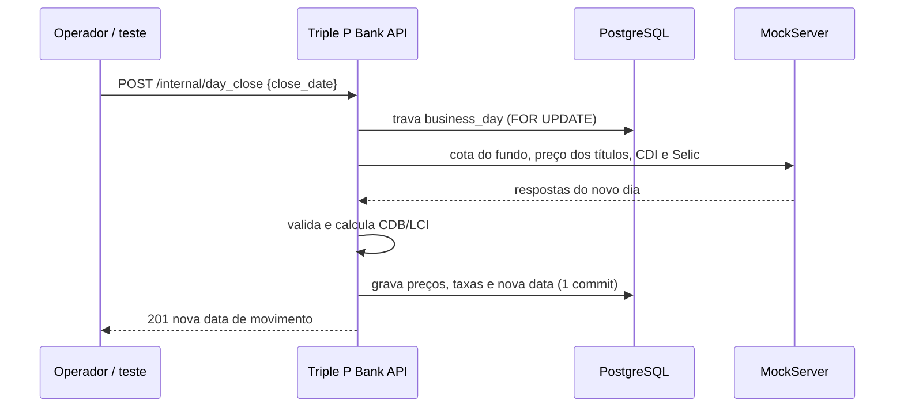

# Preço dos ativos e fechamento do dia

> Documento vivo: ele é atualizado a cada fase. A seção
> [Andamento](#9-andamento-por-fase) diz o que já está pronto, e o
> [Diário](#10-diário-de-mudanças) conta o que mudou e quando.
>
> As regras oficiais estão na RFC (`docs/regras_de_negocio.tex`, seções
> "Convenções gerais" e "Módulo 5"). Se este texto e a RFC divergirem,
> **a RFC vence**. Aqui a ideia é explicar o porquê, com exemplos.

---

## 1. O problema, em uma frase

O cliente aplica no fundo **hoje** e quer ver quanto ganhou **daqui a alguns
dias**. Mas a banca vai testar o projeto num dia só: ninguém vai esperar o
relógio virar para ver o preço mudar.

Para isso funcionar, precisamos responder três perguntas:

1. **Quem decide que dia é hoje** para o banco?
2. **De onde vem o preço novo** de cada ativo, todo dia?
3. **Como mostrar e testar** vários dias passando em poucos segundos?

---

## 2. Os conceitos (leia isto primeiro)

| Termo                 | O que é                                                                                                                                                                     | Exemplo                                                                                        |
| --------------------- | --------------------------------------------------------------------------------------------------------------------------------------------------------------------------- | ---------------------------------------------------------------------------------------------- |
| **Data de movimento** | O "hoje" do banco. É uma data guardada no banco de dados que **só avança quando alguém manda**. Não é o relógio do computador.                                              | O relógio diz 03/10, mas a data de movimento pode estar em 07/10 depois de alguns fechamentos. |
| **Fechamento do dia** | A rota `POST /internal/day_close`. Ela busca os preços do próximo dia lá fora, grava tudo e avança a data de movimento. Em banco de verdade isso se chama "virada de data". | Fecha 05/10 → abre 06/10.                                                                      |
| **Fonte externa**     | Quem publica o preço na vida real: o Tesouro, a administradora do fundo, o Banco Central.                                                                                   | A administradora publica a cota do fundo todo fim de tarde.                                    |
| **MockServer**        | Um programa que **finge ser** essas fontes externas. Ele sobe junto com o `docker compose` e responde o que a gente ensinar.                                                | "Quando pedirem a cota de 06/10, responda 102,00."                                             |
| **Connector**         | O código, em `src/connectors/`, que faz a chamada HTTP para a fonte externa. É o mesmo código que iria para produção, só muda o endereço.                                   | `FundAdminConnector` pergunta a cota do fundo.                                                 |
| **Emissão própria**   | Papel que **o próprio banco** emitiu (CDB e LCI do Triple P Bank). Ninguém de fora publica o preço dele: o banco calcula.                                                   | CDB rende 95% do CDI.                                                                          |
| **CDI**               | A taxa de juros de referência entre bancos. Vem do Banco Central, uma por dia útil.                                                                                         | 14,9% ao ano.                                                                                  |
| **Cota**              | A "fatia" de um fundo. Valor da posição = quantidade de cotas × valor da cota do dia.                                                                                       | 15 cotas × R$ 104,00 = R$ 1.560,00.                                                            |

---

## 3. O desenho

A API **nunca** busca preço na hora em que o cliente pede alguma coisa. Ela
sempre **lê o último preço gravado** na tabela `product_price`. Quem grava
preço novo é o fechamento do dia:

```
  POST /internal/day_close  {"close_date": "2026-10-05"}
        ↓
  1. trava a data de movimento (ninguém fecha o mesmo dia duas vezes)
        ↓
  2. "05/10" é mesmo a data atual?             não → 409, nada muda
        ↓
  3. próximo dia útil = 06/10 (sexta pula para segunda)
        ↓
  4. pergunta lá fora (MockServer), para 06/10:
        administradora  → cota do FGV Quant Capital
        Tesouro         → preço dos 3 títulos
        Banco Central   → CDI e Selic
        ↓
  5. as respostas fazem sentido?                não → 502, nada gravado
        ↓
  6. calcula o CDB e a LCI com o CDI que chegou
        ↓
  7. grava tudo de uma vez: 6 preços + 2 taxas + a nova data
        ↓
  201 {"business_date": "2026-10-06", "prices": [...], "rates": [...]}
```

Depois disso, qualquer rota que precise do "preço de hoje" (consultar o
produto, aplicar, ver a posição, resgatar) já usa o preço de 06/10.



---

## 4. Como cada ativo muda de um dia para o outro

As fórmulas usam `d` = **número de dias úteis desde 01/01/2026** (a "data
âncora"). Como o preço depende **só da data**, qualquer dia pode ser
calculado direto, sem saber o preço de ontem. Isso é importante porque o
MockServer **não tem memória**: ele só responde ao que perguntam.

| Ativo                  | Quem calcula          | Preço no dia `d`                                           | O que acontece no dia a dia |
| ---------------------- | --------------------- | ---------------------------------------------------------- | --------------------------- |
| Tesouro Selic 2031     | Mock (Tesouro)        | `100 × 1,15^(d/252)`                                       | Sobe um pouco todo dia      |
| Tesouro Prefixado 2029 | Mock (Tesouro)        | `100 × 1,13^(d/252)`                                       | Sobe um pouco todo dia      |
| Tesouro IPCA+ 2035     | Mock (Tesouro)        | `100 × (1,045 × 1,06)^(d/252)`                             | Sobe um pouco todo dia      |
| CDI e Selic            | Mock (Banco Central)  | 14,9% e 15% ao ano                                         | Uma taxa nova por dia útil  |
| CDB Triple P Bank      | **O banco**           | preço de ontem × (1 + CDI do dia × 95%)                    | Rende pelo CDI que chegou   |
| LCI Triple P Bank      | **O banco**           | preço de ontem × (1 + CDI do dia × 93%)                    | Rende pelo CDI que chegou   |
| FGV Quant Capital      | Mock (administradora) | `100 × (1,10 × 0,99)^(d/252) × (1 + 3% × sen((d + 15)/7))` | **Sobe e desce**            |

O "CDI do dia" é a taxa anual convertida para um dia útil:
`(1 + 14,9%)^(1/252) − 1 ≈ 0,0551%`.

**Lendo a fórmula do fundo, por partes:**

- `(1,10 × 0,99)^(d/252)`: o fundo rende 10% ao ano, e a administradora já
  desconta a taxa de administração de 1% (por isso o 0,99). É assim no
  mercado: a cota publicada já vem líquida.
- `(1 + 3% × sen((d + 15)/7))`: uma onda que sobe e desce. Num dia ruim a
  cota cai até cerca de 0,4%. Serve para mostrar que **fundo pode dar
  prejuízo**.
- O `+ 15` só empurra a onda 15 dias úteis para o lado, para outubro de 2026
  (época da apresentação) cair numa subida.
- Seno e não número aleatório: a série é sempre a mesma, então dá para
  conferir as contas e os testes não mudam de resultado.

**Números reais das fórmulas** (para conferir na mão; o seed do banco dá
exatamente estes valores):

| Data       | Dia | `d` | Fundo        | Tesouro Selic | CDB          |
| ---------- | --- | --- | ------------ | ------------- | ------------ |
| 01/10/2026 | qui | 195 | 103,65374249 | 111,42138869  | 110,74981589 |
| 02/10/2026 | sex | 196 | 103,79148268 | 111,48320134  | 110,80782057 |
| 05/10/2026 | seg | 197 | 103,99176299 | 111,54504829  | 110,86585562 |
| 06/10/2026 | ter | 198 | 104,25128086 | 111,60692954  | 110,92392107 |
| 19/10/2026 | seg | 207 | 108,20038986 | 112,16540797  | 111,44788055 |

> Em outubro de 2026 a cota do fundo **sobe o mês inteiro** (pico perto de
> 30/10, por volta de 110,8). Em novembro ela **cai** até cerca de 01/12. Ou
> seja: uma demonstração em outubro mostra ganho; para mostrar prejuízo, é só
> fechar dias até novembro.

**Por que diário e não minuto a minuto?** Fundo de investimento tem **uma cota
por dia útil** (a cota de fechamento), e renda fixa rende por dia útil. Preço
minuto a minuto só existe em ações e cripto, que estão fora do escopo.

---

## 5. A história do cliente, dia a dia

Exemplo com números redondos, do jeito que os testes vão fazer:

| Passo | Requisição                       | Data de movimento | Cota   | O que acontece                                                                                                  |
| ----- | -------------------------------- | ----------------- | ------ | --------------------------------------------------------------------------------------------------------------- |
| 1     | Cliente aplica R$ 1.500 no fundo | 05/10             | 100,00 | Recebe 15 cotas. R$ 1.500 saem do saldo e aparecem no extrato como débito.                                      |
| 2     | `POST /internal/day_close`       | 05/10 → **06/10** | 102,00 | Preço novo gravado, dia virou.                                                                                  |
| 3     | `POST /internal/day_close`       | 06/10 → **07/10** | 104,00 | Mais um dia.                                                                                                    |
| 4     | `GET /customer/{ck}/positions`   | 07/10             | 104,00 | Posição vale 15 × 104 = **R$ 1.560**. Resultado R$ 60, rentabilidade 400 pb (4%).                               |
| 5     | Resgate total                    | 07/10             | 104,00 | R$ 1.560 voltam para a conta (crédito no extrato). A resposta mostra `result_amount: 6000` e `return_bps: 400`. |

Os passos 2 e 3 levam milissegundos. É isso que deixa a banca ver a
rentabilidade mudar ao vivo.

Lembre que o valor aplicado **sai do saldo** da conta e vai para a posição.
Ele volta, com ganho ou perda, só no resgate.

---

## 6. Quando algo dá errado

O fechamento é **tudo ou nada**: ou grava tudo, ou não grava nada.

| O que aconteceu                                                            | Resposta        | O que muda no banco |
| -------------------------------------------------------------------------- | --------------- | ------------------- |
| O `close_date` não é a data atual (por exemplo, clique duplo)              | 409 `PPP000006` | Nada                |
| Fonte externa fora do ar, demorou mais de 5 s ou respondeu erro            | 502 `PPP005006` | Nada                |
| Fonte respondeu algo sem sentido (cota zero, data errada, título faltando) | 502 `PPP005007` | Nada                |

Se o fechamento falhar, a data de movimento não anda, e o sistema continua
usando o último preço publicado. É só chamar de novo quando a fonte voltar.

Por que não gravar "o que deu"? Porque **preço publicado não se reescreve**
(R4). Gravar um preço errado é pior do que ficar um dia sem preço novo.

---

## 7. Como testar e demonstrar

### Nos testes automáticos

Os testes continuam black box (R1): só HTTP. Eles conversam com dois
servidores, a nossa API e o MockServer:

```
1. ensina o mock      PUT http://localhost:1080/mockserver/expectation
                      "cota do fundo em 06/10 = 102,00"
2. chama a nossa API  POST /internal/day_close
3. confere            GET /product/{key} mostra 102,00
```

Assim o teste escolhe números redondos e também consegue simular falhas:
erro 500, demora e conexão derrubada.

Duas regras para quem escreve teste:

- **Nunca conferir data fixa.** A data de movimento é uma só para o banco
  inteiro e só anda para frente, então cada execução da suíte a deixa mais
  adiante. Confira **relações** ("a posição vale cotas × cota do dia") e leia
  a data atual por `GET /internal/business_date`.
- **Não apagar o mock inteiro.** Use `PriceSourceMock.teach_day(dia)`: ele
  apaga só o que o mock sabia **daquele dia** e ensina as quatro respostas
  do teste, com prioridade maior. Para simular uma falha, use
  `teach_day(dia, skip="fund")` e depois `PriceSourceMock.server_error("fund", dia)`.
- Depois de rodar a suíte, a demonstração manual precisa de ambiente novo:
  `docker compose down -v` e `docker compose up -d`. Os testes apagaram do
  mock os primeiros dias do cenário.

### Na demonstração manual

Um container chamado `mock-init` roda uma vez quando o compose sobe e ensina
ao mock os próximos 60 dias úteis pelas fórmulas da seção 4. Então dá para
chamar o fechamento direto, sem preparar nada (o roteiro com `curl` entra no
README na Fase 6).

---

## 8. Decisões tomadas (e o que ficou de fora)

O registro completo, com o preço de cada alternativa, está na seção
"Decisões e alternativas descartadas" da RFC. Resumo:

| Escolhemos                                                       | No lugar de                                                 | Por quê                                                                                                                                                                           |
| ---------------------------------------------------------------- | ----------------------------------------------------------- | --------------------------------------------------------------------------------------------------------------------------------------------------------------------------------- |
| Data de movimento própria                                        | Relógio real                                                | Com o relógio, o "amanhã" demora 24 horas: não dá para mostrar nem testar.                                                                                                        |
| Idade e validade do perfil pelo relógio real                     | Pela data de movimento                                      | São regras da lei; a data de movimento do simulador fica à frente do calendário e aceitaria um menor de verdade.                                                                  |
| Fechamento chamado por rota                                      | Agendador (cron)                                            | A banca precisa controlar quando o dia vira. Em produção, um agendador chamaria a mesma rota.                                                                                     |
| Connectors + MockServer                                          | Banco calculando tudo por função SQL                        | Em produção o banco **recebe** a cota do fundo, não inventa. E mostra o que a Aula 3 ensinou.                                                                                     |
| Buscar preço uma vez por dia                                     | Buscar na hora em que o cliente pede                        | O cliente não fica dependendo de serviço externo, e todos veem o mesmo preço no dia.                                                                                              |
| Fórmula que depende só da data                                   | Seno acumulado dia a dia (versão antiga do seed)            | O mock não tem memória.                                                                                                                                                           |
| Histórico de taxas em `reference_rate`                           | Uma taxa fixa / apagar a tabela                             | Uma taxa fixa criaria dois CDIs diferentes, e o relatório de receita precisa das taxas.                                                                                           |
| Preço diário                                                     | Preço intradiário                                           | Fundo tem uma cota por dia; renda fixa rende por dia útil.                                                                                                                        |
| Preço só pelo fechamento do dia                                  | Rota de publicação manual (`POST /product/{key}/price`)     | Preço não se reescreve, o fechamento não deixa buraco e fim de semana usa o último preço: a rota só conseguia gravar dias que ninguém lê. E o teste dela apagava o banco inteiro. |
| LCI como oferta com prazo de 12 meses (vencimento por aplicação) | LCI com vencimento fixo e prazo mínimo checado na aplicação | Emissão própria é uma emissão nova a cada aplicação. Com vencimento fixo, a LCI ficaria bloqueada nos últimos 9 meses. O prazo mínimo do CMN virou `CHECK` no banco.              |
| Seed só com o preço de hoje                                      | Seed com os últimos 30 dias                                 | Nenhuma regra lê preço de antes do banco nascer: aplicação, resgate e fechamento só usam o último preço até a data de movimento. O histórico era só decoração.                    |

**Fica para depois (incrementos):**

- feriados no fechamento;
- marcação a mercado do Prefixado e do IPCA+ (no mercado real eles caem
  quando os juros sobem);
- benchmark contra o CDI usando o histórico de taxas;
- liquidação automática no vencimento (RN-FEC-09), junto com o módulo 7.

---

## 9. Andamento por fase

Legenda: ✅ pronto · 🔄 em andamento · ⬜ não começou

| Fase | O que entrega                                                                         | Status |
| ---- | ------------------------------------------------------------------------------------- | ------ |
| 0    | RFC com todas as regras, rotas, erros, contratos e decisões                           | ✅     |
| 1    | Data de movimento: tabela e rota                                                      | ✅     |
| 2    | Módulo 5 (produtos e preços) já com data de movimento, histórico de taxas e seed novo | ✅     |
| 3    | MockServer no compose, `mock-init` e utilitários de teste                             | ✅     |
| 4    | Connectors e `POST /internal/day_close`                                               | ✅     |
| 5    | Teste ponta a ponta: aplica → vira o dia → posição → resgate (com o módulo 7)         | ⬜     |
| 6    | Roteiro de demonstração no README                                                     | ⬜     |

### Fase 0: RFC ✅

**Objetivo:** escrever as regras antes do código, para o time inteiro
concordar com o desenho.

**O que mudou em `docs/regras_de_negocio.tex`:**

- **RN-GER-13** (nova): a data de movimento, o "hoje" do banco.
- **RN-GER-03**: `created_at` continua com a hora real (auditoria); regras
  usam a data de movimento.
- **"Hoje" virou "data de movimento"** em: vencimento de produto
  (RN-PRO-03, RN-ORD-11), preço do dia (RN-PRO-04) e publicação de preço
  (RN-PRO-05, removida depois: ver Diário de mudanças). A idade mínima (RN-CLI-05) e a validade do perfil (RN-SUI-05)
  também tinham mudado, mas voltaram para a data real em 04/10 (ver Fase 1).
- **RN-PRO-06** e parâmetros do seed: as fórmulas da seção 4, com a data âncora
  01/01/2026 e o `external_code` de cada produto.
- **Seção nova "Fechamento do dia e fontes externas de preço"**: regras
  RN-FEC-01 a RN-FEC-08 e a tabela de contratos dos mocks.
- **RN-REC-04, 05, 08 e 09**: taxa de administração já na cota, histórico de
  taxas e período do relatório pela hora real.
- **Modelo de dados**: tabela `business_day`, `reference_rate` com
  `reference_date`, `product.external_code`.
- **Rotas**: `GET /internal/business_date` e `POST /internal/day_close`.
- **Erros**: `PPP000006`, `PPP005006`, `PPP005007`.
- **Testes previstos**: nova linha "Fechamento do dia".
- **Decisões**: 9 alternativas novas ou reescritas (seção 8 deste texto).
- **Incrementos**: saiu "connector + MockServer" (agora faz parte do MVP);
  entraram feriados e marcação a mercado.
- **Diagrama ER**: `business_day`, `reference_rate` e `external_code`.

**O que mudou em `docs/rfc_fluxos.tex`:**

- Fluxo novo **"Fechamento do dia"**: caminho feliz e as três falhas.
- Aplicação, resgate e suitability passaram a falar em data de movimento.

**Ainda não conferido:** os `.tex` não foram compilados (a máquina onde a
Fase 0 foi feita não tem LaTeX). Só se conferiu que chaves e ambientes
continuam balanceados.

### Fase 1: data de movimento ✅

**Objetivo:** criar o "hoje" do banco, que os produtos (Fase 2) e o
fechamento (Fase 4) vão usar.

**Decisão revista antes de começar:** a idade mínima e a validade do perfil
**voltaram para a data real**. As duas são regras da lei, valem no mundo
real. E no nosso simulador a data de movimento fica à frente do calendário
(cada vez que a suíte roda, ela anda alguns dias). Se a idade usasse essa
data, alguém com 17 anos de verdade poderia abrir conta. Nenhum teste de
investimento depende dessas duas regras. Por isso o `customer_controller.py`
e os testes de idade **não mudaram**, e `valid_until` continua
`TIMESTAMPTZ`. Continuam na data de movimento: vencimento do produto, preço
do dia e taxas. A RFC (RN-GER-13, RN-CLI-05, RN-SUI-05, modelo de dados,
fluxos e decisões) foi ajustada.

**O que mudou:**

- `database/database.sql`: tabela `business_day` e a primeira linha com a
  data real (`CURRENT_DATE`).
- `src/models/business_day.py`, `src/repositories/business_day_repository.py`
  (`get_current`: a linha com a maior data), `business_day_controller.py` e
  `resources/business_day.py`.
- `GET /internal/business_date` → `200 {"business_date": "2026-10-04"}`.
- Testes em `tests/integration/test_business_day.py`: formato da resposta e
  403 sem token. Primeiro falhou (404, rota inexistente), depois passou.
- `pytest -v`: 62 passed.

**Ficou para depois:** `get_current_for_update` entra na Fase 4, quando o
fechamento precisar travar a data.

**Conferência final:** em `src/`, o único uso do relógio real é a idade do
cliente (a validade do perfil também usará, quando o suitability existir).

### Fase 2: produtos e preços ✅

**Objetivo:** o catálogo e o preço do dia, já lendo a data de movimento, com
o seed nas fórmulas que o mock vai usar.

**O que mudou no `database.sql`:**

- `reference_rate` virou histórico: ganhou `reference_date` e
  `UNIQUE(code, reference_date)`. O seed grava CDI 14,9% e Selic 15% com
  a data de hoje (era hoje − 29 até 05/10).
- `product.external_code`: como o Tesouro e a administradora chamam o
  produto (nulo no CDB e na LCI, que são do banco).
- Seed de preços reescrito com as fórmulas da seção 4 (com a onda deslocada).
  Eram 30 dias corridos por produto; desde 05/10 é **só o preço de hoje**
  (ver seção 8).

**Rotas novas (Módulo 5):**

| Rota                                  | O que faz                                                          |
| ------------------------------------- | ------------------------------------------------------------------ |
| `GET /products?type=&max_risk=`       | Catálogo, com filtros por tipo e risco máximo.                     |
| `GET /product/{key}`                  | Detalhe do produto + `price` do dia (`null` se não houver nenhum). |
| `GET /product/{key}/prices?from=&to=` | Histórico de preços, do mais antigo ao mais novo.                  |

O `unit_price` sai **como texto** (`"102.50000000"`), para ninguém ler como
`float`. Erro novo: `PPP005001` (produto não existe).

> Esta fase também criou `POST /product/{key}/price` (publicação manual de
> preço, `PPP005004` e `PPP005005`). Ela foi **removida** em 04/10: não havia
> dia que ela pudesse corrigir (ver seção 8).

**Testes:** `tests/integration/test_product.py`, com 27 casos. Primeiro
falharam todos, depois passaram. `pytest -v`: 89 passed, também numa segunda
rodada seguida.

**Bug antigo encontrado:** o `DbUtils.rollback()` (o utilitário que recria o
banco nos testes) quebrava com qualquer `%` no `database.sql`, como em
`'100% da Selic'`. Ninguém tinha notado porque nenhum teste o chamava ainda.
Corrigido em `tests/utils/db_utils.py`.

**Ficou para depois:**

- model e repository de `reference_rate`: entram na Fase 4, quando o
  fechamento gravar taxas;
- `PPP005002` e `PPP005003` (produto indisponível, sem preço): entram com as
  ordens, que é quem os usa.

### Fase 3: infraestrutura do mock ✅

**Objetivo:** deixar as "fontes de fora" de pé antes de escrever o código
que conversa com elas (Fase 4).

**O que mudou:**

- `docker-compose.yml`: voltou o serviço `mock` (mesma imagem fixa do
  repositório-base, `mockserver-5.11.1`) e entrou o `mock-init`. Esse é um
  container `python:3.11-slim` que roda `mock/mock_init.py` uma vez e
  termina. O script usa só a biblioteca padrão, então não há dependência
  nova.
- O `mock-init` ensina ao mock **60 dias úteis a partir da data real** em
  que o compose sobe, para os três serviços: cota do fundo, preços do
  Tesouro, CDI e Selic. No log aparece, por exemplo:
  `mock-init: 60 dias úteis ensinados, de 2026-10-05 a 2026-12-25.`
- Conferido: a resposta do mock e a fórmula do seed no Postgres dão **o mesmo
  número até a 8ª casa** (fundo e os três títulos, em 4 datas diferentes).
- `tests/utils/mock_utils.py`: recuperado do commit `3d66ecb`, só com o que
  usamos. Ficou **sem** `clear()` de propósito: apagar o mock apagaria o
  cenário da demonstração.
- `tests/utils/price_source_mock.py` (`PriceSourceMock`): os testes ensinam
  números redondos, por exemplo `PriceSourceMock.fund_quote(dia, "102.00")`.
  Cada resposta tem **prioridade maior** que a do cenário e vale para **uma
  chamada só**; depois o mock volta a responder o cenário. Assim um teste
  não deixa resposta pendurada para o próximo.
- `.env.example`: documenta o `MOCK_PORT`.

**Duas decisões de contrato** (registradas na RFC):

- o CNPJ vai **só com dígitos** no caminho
  (`/fund-admin/funds/12345678000195/quotes`), porque a `/` do CNPJ
  quebraria o endereço;
- preços e taxas vão **como texto** (`"VL_QUOTA": "103.99176299"`), como já
  faz a API do Banco Central. Assim o connector lê `Decimal`, nunca `float`.

**Testes:** `tests/integration/test_price_source_mock.py`, com 5 casos que
conversam direto com o mock (black box, só HTTP). Eles conferem que o cenário
existe, que o fim de semana não é ensinado e que a resposta de teste ganha
uma vez e depois some. Primeiro falharam (sem mock), depois passaram.
`pytest -v`: 94 passed, também numa segunda rodada seguida.

**Ficou para depois:** as respostas de erro (500, conexão derrubada, resposta
sem sentido) entram no `PriceSourceMock` na Fase 4, junto com os testes do
fechamento que as usam.

**Atenção:** o cenário cobre só 60 dias úteis a partir do dia em que o
compose subiu. Se a data de movimento passar disso, o fechamento recebe 404
do mock (vai virar 502). `docker compose down -v` e `up` recomeçam tudo.

### Fase 4: connectors e fechamento do dia ✅

**Objetivo:** o dia virar de verdade, buscando preço lá fora.

**O que mudou:**

- `src/connectors/price_source_connector.py`: `FundAdminConnector`,
  `TreasuryConnector` e `CentralBankConnector`, sobre o `RestConnector` do
  repositório-base. Timeout de 5 s. Quando não há resposta (fora do ar,
  timeout, conexão derrubada), eles devolvem `None`, e quem decide que isso
  vira 502 é o controller. O `INTERNAL-TOKEN` desta API **não** é mandado
  para fora.
- Os endereços vêm de variável de ambiente (`FUND_ADMIN_API_URL`,
  `TREASURY_API_URL`, `CENTRAL_BANK_API_URL`). No compose apontam para o
  mock; em produção mudaria só isso.
- `POST /internal/day_close` no `BusinessDayController`. Ele faz os passos
  da seção 3 nesta ordem:
  1. trava a data e **relê** a data atual;
  2. pergunta à administradora, ao Tesouro e ao Banco Central (CDI e Selic),
     conferindo cada resposta;
  3. calcula o CDB e a LCI;
  4. grava tudo e dá `commit` uma vez só.
- Models e repositories novos: `ReferenceRate` / `ReferenceRateRepository`;
  `BusinessDayRepository` ganhou `get_current_for_update` e `create`.
- Erros: `PPP000006` (409), `PPP005006` e `PPP005007` (502).
- O `parse_date` saiu do controller de produto para `src/utils/dates.py`,
  junto com o `next_business_day`.

**Um furo no fluxo da RFC, corrigido:** com dois fechamentos ao mesmo tempo,
o segundo esperava a trava e depois conferia a data com a linha **antiga**
(ela continua existindo), e fecharia o dia de novo. Agora a data é relida
depois da trava. Conferido com três pedidos simultâneos: um 201 e dois 409,
um dia só gravado. RFC e fluxos atualizados.

**Como o fechamento recusa uma resposta "sem sentido" (502 `PPP005007`):**

- data diferente da pedida, ou CNPJ diferente do produto;
- título faltando;
- campo faltando, ou corpo que não é o formato combinado;
- preço ou taxa ≤ 0, que não é número, ou que veio como número JSON em vez
  de texto;
- mais de uma taxa na lista.

**Testes:** `tests/integration/test_day_close.py`, com 22 casos:

- abre o próximo dia útil, e sexta → segunda;
- grava 6 preços e 2 taxas, e o produto mostra a cota que o mock respondeu;
- CDB = preço anterior × (1 + c × 95%);
- `close_date` errado e clique duplo dão 409 sem mudar nada;
- erro 500 em cada uma das 4 fontes, conexão derrubada e 6 tipos de resposta
  sem sentido dão 502, sem gravar nada e sem mudar a data.

Primeiro falharam todos, depois passaram. `pytest -v`: **116 passed**, em
três rodadas seguidas.

**Ajuste no `PriceSourceMock`:** a primeira rodada (antes da rota existir)
deixou respostas ensinadas e não consumidas no mock, que atrapalhariam a
rodada seguinte. Primeiro o `teach_day` apagava o que o mock sabia daquele
dia (`clear_request`), mas isso levava junto o cenário da demonstração: depois
de umas 2 rodadas, o `test_price_source_mock.py` dava 404. Agora toda resposta
de teste tem um id fixo por fonte e dia (`test-{fonte}-{dia}`), e o MockServer
troca a resposta de mesmo id em vez de empilhar. A sobra some, e o cenário do
`mock-init` (que tem outro id) fica intacto. Limite que sobra: o `mock-init`
só ensina 60 dias úteis, então a demonstração manual sai da janela depois de
muitas rodadas sem `docker compose down -v`.

**Demonstração manual conferida:** com ambiente novo e sem ensinar nada,
`POST /internal/day_close {"close_date": "2026-10-04"}` abriu 05/10 com os
preços da tabela da seção 4 (fundo 103,99176299).

**Ficou de fora:** um teste automático de _timeout_ de verdade (5 s de
espera deixariam a suíte lenta). O caminho é o mesmo da conexão derrubada,
que está testada.

### Fase 5: ponta a ponta ⬜

**Planejado:** o teste da seção 5, junto com o módulo de ordens e posição.

### Fase 6: apresentação ⬜

**Planejado:** roteiro de demonstração com `curl` no README.

---

## 10. Diário de mudanças

| Data       | Fase | O que mudou                                                                                                                                                                                                                                                                                         |
| ---------- | ---- | --------------------------------------------------------------------------------------------------------------------------------------------------------------------------------------------------------------------------------------------------------------------------------------------------- |
| 03/10/2026 | 0    | RFC atualizada com data de movimento, fechamento do dia, contratos dos mocks, histórico de taxas e fórmulas novas. Documento criado.                                                                                                                                                                |
| 04/10/2026 | 1    | Idade mínima e validade do perfil voltaram para a data real (RFC ajustada). Tabela `business_day` e `GET /internal/business_date` prontas.                                                                                                                                                          |
| 04/10/2026 | 2    | Onda do fundo deslocada para `sen((d + 15)/7)` (outubro sobe). Seed novo, `reference_rate` com histórico, `external_code` e as 4 rotas de produto. Corrigido o `DbUtils.rollback()` com `%` no SQL.                                                                                                 |
| 04/10/2026 | 3    | MockServer e `mock-init` no compose (60 dias úteis ensinados pelas fórmulas, iguais ao seed até a 8ª casa). `PriceSourceMock` para os testes. CNPJ só com dígitos no caminho e preços como texto (RFC).                                                                                             |
| 04/10/2026 | 4    | Connectors e `POST /internal/day_close` prontos. Corrigido o fluxo de clique duplo (reler a data depois da trava). `teach_day` passa a limpar o dia no mock antes de ensinar.                                                                                                                       |
| 04/10/2026 | 2    | Removida a rota `POST /product/{key}/price` (RN-PRO-05, `PPP005004`, `PPP005005`) e os testes dela. Com isso nenhum teste chama mais o `DbUtils.rollback()`, e os dados criados pela suíte ficam no banco.                                                                                          |
| 05/10/2026 | 2    | Seed de preços e taxas reduzido ao dia em que o banco nasce (eram 30 dias). RFC ajustada.                                                                                                                                                                                                           |
| 05/10/2026 | 2    | LCI virou "LCI Triple P Bank 12 meses": `term_months` e `tax_exempt` em `product`, `CHECK` do prazo mínimo de 9 meses (Res. CMN 5.119 e 5.168/2024). RFC: RN-PRO-09, RN-ORD-17, RN-FEC-09 (rascunho, liquidação no vencimento) e "Do MVP à produção". O fechamento continua calculando a LCI igual. |
| 05/10/2026 | —    | Banco renomeado de Quant Bank para **Triple P Bank**; códigos de erro de `PPP` para `PPP` (mesmo formato); serviço `triple-p-bank-api`. O fundo continua FGV Quant Capital.                                                                                                                         |

---

## 11. Perguntas frequentes

**Se eu deixar o sistema ligado por dias, o preço some?**
Não. O preço do dia é o **último até a data de movimento**. Se ninguém fechar
o dia, a data não anda e o preço fica o mesmo.

**Por que o CDB não vem do mock, como os outros?**
Porque foi o próprio banco que emitiu. Na vida real ninguém de fora publica
esse preço: o banco calcula a partir do CDI, que vem do Banco Central.

**O MockServer é "trapaça"?**
Não. Ele imita o **contrato** de serviços que existem (o formato do Banco
Central é igual ao da API pública real). Trocar o mock pelo serviço real é
mudar só o endereço numa variável de ambiente.

**E se dois colegas chamarem o fechamento ao mesmo tempo?**
O primeiro trava a data de movimento. O segundo espera, relê a data depois
da trava, encontra a data já avançada e recebe 409. Fecha-se um dia só
(testado com três pedidos ao mesmo tempo: um 201 e dois 409).

**Por que os testes não podem conferir uma data fixa?**
Porque a data de movimento é uma só para o banco inteiro e só anda para
frente. Depois de algumas execuções da suíte, ela está semanas à frente do
calendário. `docker compose down -v` volta tudo ao começo.
